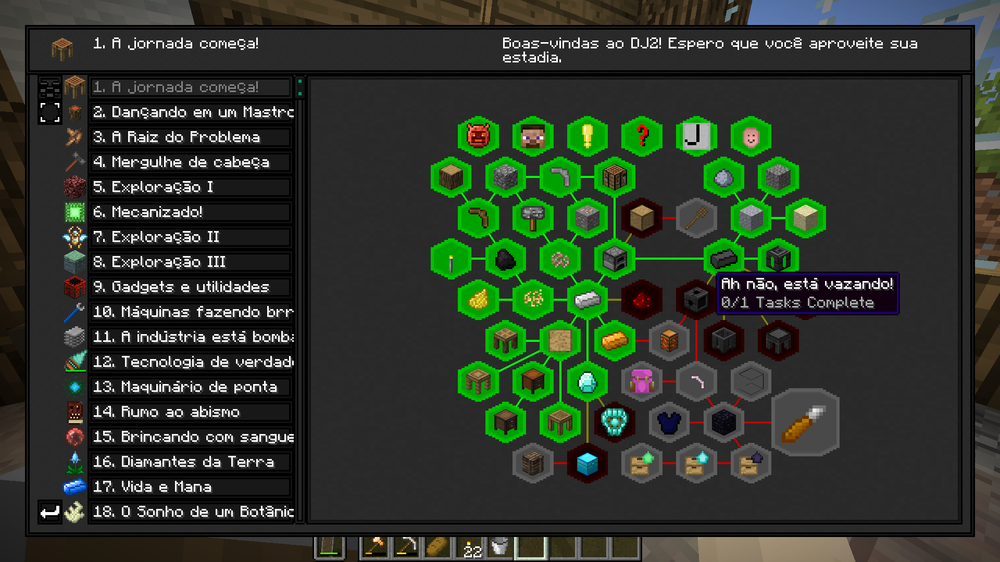

# Tradução do Divine Journey 2 (PT-BR)

 -100%25-brightgreen) 

Este repositório contém a tradução para o português do Brasil do livro de missões do modpack **Divine Journey 2**.

Fiz a tradução para a versão **2.23.4**. Se você usar em outra versão, algumas quests podem ficar em inglês ou apresentar erros de leitura.

## 📊 Progresso da Revisão

Todo o livro de missões já está 100% traduzido e jogável! Atualmente estou revisando capítulo por capítulo para corrigir termos técnicos dos mods, adaptar trocadilhos e melhorar a fluidez do texto.

`[█░░░░░░░░░░░░░░░░░░░░░░░░░░░░░] 1 / 30 Capítulos (3.3%)`

- ✅ **Revisados e refinados:** Capítulo 1
- 🤖 **Tradução base (IA) aguardando revisão:** Capítulos 2 ao 30

## 📂 Como instalar

1. Baixe o arquivo `pt-br.lang` aqui do repositório (ou na aba de **Releases**).
2. Abra a pasta do seu modpack (pelo CurseForge, Prism Launcher, SKlauncher, etc.).
3. Navegue até o caminho `divine-journey-2/resources/betterquesting/lang`.
4. Faça um backup do arquivo `en_us.lang` original, caso queira desfazer depois.
5. Renomeie o arquivo `pt-br.lang` que você baixou para **`en-us.lang`**.
6. Substitua o arquivo original pelo que você baixou.
7. Inicie o jogo. O livro do Better Questing já estará em português.

## ⚙️ Como a tradução foi feita

O arquivo original de idioma é muito longo e cheio de códigos de formatação do Minecraft (como cores e quebras de linha `%n`). Para não quebrar o mod, automatizei a tradução base usando a API da OpenAI.

Separei o texto em lotes (batch) e configurei o prompt da IA para traduzir apenas o texto depois do sinal de `=`, mantendo as chaves originais intactas. Após essa etapa, criei um script em Python para extrair e organizar as quests por capítulo, permitindo fazer uma revisão fina e corrigir eventuais erros de sintaxe ou contexto.

## 📜 Créditos

O **Atricos** e a equipe de desenvolvimento dele criaram o Divine Journey 2 e todo o conteúdo original das quests. Este repositório é apenas um projeto de fã para ajudar a comunidade brasileira a jogar o modpack, sem nenhum vínculo oficial com os criadores.
